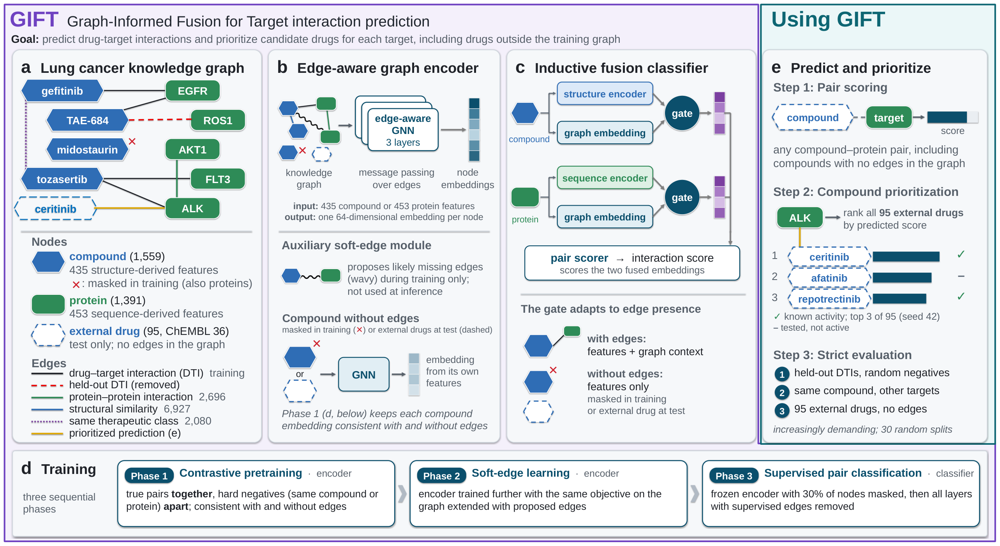

# GIFT: Graph-Informed Fusion for Target interaction prediction

### Inductive drug-target interaction prediction and compound prioritization

#### Authors: Luis H. M. Torres, Sumaiya Iqbal, Ashley Mae Conard

## What is GIFT?

Predicting which compounds act on a disease protein helps decide which compounds to test, but most candidate
compounds have few or no known interactions. Pairwise DTI models score each compound-protein pair from molecular
features alone, whereas graph models use a network of known interactions but have nothing to aggregate for a
compound without graph connections.

**GIFT** (Graph-Informed Fusion for Target interaction prediction) combines both. An edge-aware graph neural
network learns compound and protein representations from a knowledge graph of bioactivity, protein-protein, and
compound-compound relationships, and an inductive fusion classifier adds this graph context to feature-based
encodings through a gate, so that a single model predicts drug-target interactions (DTIs) and ranks compounds for a
target, **including compounds outside the training graph**. GIFT is evaluated under a leakage-free protocol in which
every validation and test interaction is removed from the graph before training, and is demonstrated on lung
cancer-associated targets.



**Overview of GIFT.** (a) Lung cancer knowledge graph of compounds and proteins; held-out DTIs are removed and the
95 external drugs enter without edges. (b) Edge-aware graph encoder, which also embeds compounds without edges; the
soft-edge module proposes edges during training only. (c) Inductive fusion classifier: per-node gates fuse feature
and graph embeddings, and a pair scorer outputs the interaction score. (d) Three sequential training phases.
(e) Pair scoring, compound prioritization, and the three benchmarks.

## Quick start: 3 steps

Reproduce the paper's tables and figures from the saved per-run results (no training; minutes on a CPU):

1. Clone the repository and install the main environment:

   ```bash
   git clone https://github.com/ashleyatmsft/gift.git
   cd gift
   pip install -r requirements.txt
   ```

2. Rebuild the main tables, paired tests, and figures:

   ```bash
   bash scripts/05_paper_numbers.sh     # writes results/gift/paper_numbers.txt and figures/
   ```

3. Rebuild the robustness analyses of the supplement:

   ```bash
   bash scripts/06_robustness.sh
   ```

All results come from 30 training runs (seeds 42-71), each with its own random 70/15/15 split of the 14,453
measured ChEMBL 35 pairs. To retrain GIFT and every baseline, see [Reproducing the paper](#reproducing-the-paper).

## Paper and citation

The paper is under review. If you use GIFT, please cite:

Torres, L. H. M., Iqbal, S., & Conard, A. M. Graph-Informed Fusion for Inductive Drug-Target Interaction Prediction
and Compound Prioritization in Lung Cancer.

```bibtex
@article{torres_gift,
  title  = {Graph-Informed Fusion for Inductive Drug-Target Interaction Prediction and Compound Prioritization in Lung Cancer},
  author = {Torres, Luis H. M. and Iqbal, Sumaiya and Conard, Ashley Mae},
  note   = {Under review}
}
```

The LaTeX sources of the paper and its supplement are in [`manuscript/`](manuscript/).

## Installation and requirements

```bash
pip install -r requirements.txt          # main environment (Python 3.12, PyTorch 2.8, PyG 2.8)
# DrugBAN only, in a separate environment (DGL must match your CUDA/PyTorch build; Blackwell GPUs need DGL built from source):
pip install -r requirements-drugban.txt
# DTIAM only (AutoGluon 0.5.2 needs Python 3.9) plus the official DTIAM code and its BerMol weights:
pip install -r requirements-dtiam.txt
```

- **Tested with** Python 3.12, PyTorch 2.8 (CUDA 12.8), and one NVIDIA Blackwell GPU.
- **Hardware:** the quick start runs on a CPU; retraining needs one GPU per run (ESM-2 Phase 2 needs about 19 GB of
  GPU memory per job).
- **Disk:** about 3 GB (trained models, graphs, and per-run scores).
- **External downloads** (not included, only needed for specific steps): ChEMBL 35/36/37 SQLite releases
  (`CHEMBL35_DB`, `CHEMBL36_DB`; only to rebuild graphs, labels, or the temporal analysis), the official DTIAM code
  and BerMol weights (`DTIAM_DIR`), GuacaMol SMILES (`GUACAMOL_SMILES`), and `fair-esm` with the ESM-2 650M weights
  (downloaded automatically).

## Details

### Key results (mean over 30 runs)

| Benchmark | MCC, GIFT | MCC, best baseline |
|---|---|---|
| Held-out ChEMBL 35 interactions, random negatives | **0.818** | 0.723 (GraphDTA) |
| Held-out ChEMBL 35 interactions, compound-matched negatives | **0.564** | 0.470 (DeepDTA) |
| 95 clinical-stage drugs outside the training graph (ChEMBL 36) | **0.342** | 0.231 (GraphDTA) |

GIFT has the highest PR-AUC, precision, and MCC of all nine methods (random forest, GCN, GraphSAGE, GAT, DeepDTA,
GraphDTA, DrugBAN, and the pretrained-representation model DTIAM) on every benchmark; DTIAM's MCC is 0.198 on the
external drugs and 0.199 in target identification. For compound prioritization of the 95 drugs against ten actionable
driver kinases of non-small cell lung cancer, GIFT places on average 4.8 known actives among its 10 top-ranked drugs,
compared with at most 4.3 for DeepDTA, GraphDTA, DrugBAN, and DTIAM and 1.6 expected at random.

**Further results in the supplement** (each reproduced by the scripts listed under *Where each result comes from*):
Node masking improves the external MCC (0.342 vs 0.326 without it, p=0.04), whereas removing the contrastive pretraining
leaves the MCC and the driver-kinase shortlist unchanged and raises the external ROC-AUC (0.760 vs 0.725); the Phase 3
supervised fusion training and the edge-aware encoder carry the performance. GIFT beats the pretrained-representation baseline DTIAM on PR-AUC, precision, MCC, and ROC-AUC in all 30 runs on every
benchmark (external MCC 0.342 vs 0.198; target-identification MCC 0.564 vs 0.199; driver kinases with a known active
ranked first 6.7 vs 4.4). The descriptor-only control ranks the driver-kinase shortlist as well as full GIFT (top-10
47.9 vs 47.5), so the graph adds recall for new compounds rather than shortlist ranking. At every fixed budget
(50-1,000 selected pairs) GIFT recovers more known actives than every DTI baseline on the external benchmark.
Domain-preserving protein crops do not significantly change DeepDTA, GraphDTA, or DrugBAN (all p >= 0.06).
Held-out positives appear among training negatives at a rate below 0.04%, and evaluation negatives are never used
in training.

### Repository layout

```
code/                 Python modules and entry points (run from the repository root)
  robustness/                    scripts of the review analyses (scripts/06_robustness.sh)
  third_party/DrugBAN_9923f8c/   official DrugBAN implementation (MIT licence), unmodified
scripts/              pipeline: 01 graphs, 02 GIFT, 03 controls, 04 baselines, 05 paper numbers and figures,
                      06 review analyses, 07 DTIAM, 08 domain crop, 09 ablations, 10 ESM-2, 11 temporal/similarity/fixed budget
data/
  graphs/             graph_seed{42..71}.pkl  knowledge graph + labels + split of each run
                      graph_base.pkl               base graph (input of 01_build_graphs.sh)
  external_compounds_features.pkl   features of the 95 external clinical-stage drugs
  external_compounds_labels.pkl      ChEMBL 36 interaction labels of the external drugs
  chembl_lung_cancer_all_compounds.csv  SMILES of the graph compounds (DeepDTA, GraphDTA, DrugBAN inputs)
  protein_sequences.json            protein sequences
  protein_kinase_annotation.json       kinase annotation of the proteins
  chembl_names.json, chembl_parent_names.json, chembl37_driver_activities.json  drug names, ChEMBL 37 evidence
results/
  gift/               GIFT runs, controls, and all baselines (see below)
  backbones/          Phase 1-2 encoders of GIFT and of the no-soft-edge control
  robustness/         review analyses (one folder per study: negative overlap, measured activity and thresholds,
                      fixed budget, domain crop, temporal and direct target, similarity strata, DTIAM, ablations, ESM-2)
validation_results_chembl36/  default output folder of the temporal-validation scripts (code/pipeline_utils.py)
figures/              figures regenerated by scripts/05_paper_numbers.sh; architecture.pptx and detailed_overview.pptx are the editable layouts of Figure 1 and Supplementary Figure S1
manuscript/           LaTeX sources: main.tex = paper, supplementary.tex = supplement (both read supplementary_labels.tex)
```

#### Results and trained models (`results/`)

| Path | Contents |
|---|---|
| `backbones/backbone_seed_S/` | GIFT encoder after Phase 1 (`best_model_phase1.pth`) and Phase 2 (`best_model_phase2.pth`) |
| `gift/run_S/` | **GIFT**: final model `e2e/trained_model.pth`; metrics `eval_final.json` (ChEMBL 35 benchmarks), `eval_external_matched.json` (external drugs); `lead_prioritization.json`; `soft_edge_proposals.json`; `misclassification/` (t-SNE, seed 42 used in the paper) |
| `gift/ablation_no_softedge_seed_S/` | GIFT without soft edges (model + metrics); backbone in `backbones/ablation_no_softedge_seed_S/backbone/` |
| `gift/descriptor_only_seed_S/` | descriptor-only control (graph term of the fusion disabled) |
| `gift/random_aug_seed_S/` | matched random graph augmentation control (backbone + model + metrics) |
| `gift/baseline_models/rf/` | random forest (`rf_seed_S.joblib`, metrics) |
| `gift/baseline_models/gnn/` | GCN, GraphSAGE, GAT (`{gcn,sage,gat}_seed_S.pth`, `gnn_baselines_std_seed_S.json`) |
| `gift/baseline_models/controls/` | GCN ladder controls A (dot decoder) and B (fusion classifier) |
| `gift/baseline_models/drugban/` | DrugBAN weights (`drugban_seed_S.pth`); metrics and scores in `drugban/run_S/` |
| `gift/dta_leadprio/` | DeepDTA, GraphDTA: weights (`models/`), metrics, lead prioritization |
| `robustness/dtiam/` | DTIAM: per-run metrics, scores, driver-kinase rankings, pretraining-overlap audit (`runs/run_S/`) |
| `robustness/<study>/` | per-study outputs of the review analyses (see the table below) |
| `gift/*.json` | aggregate analyses (main table, target specificity, external generalization, measured activity, soft-edge proposals) |

Every metrics file stores the scores on the same benchmarks: held-out ChEMBL 35 interactions with random negatives
(`same_version`), with compound-matched negatives (`same_version_matched`), and the external drugs (`external` /
`cross_version`).

### Reproducing the paper

All commands run from the repository root. Each pipeline script accepts a list of seeds (default 42–71).

**Tables, figures, and numbers from the saved results** (no training, CPU):

```bash
bash scripts/05_paper_numbers.sh
```

This runs the split and leakage audit and writes the main-table rows and paired tests
(`results/gift/paper_numbers.txt`), the attribution and control analyses (`attribution_numbers.txt`), the
target-specificity, external-generalization, measured-activity, and soft-edge analyses, and Figure 2 and Supplementary
Figures S2-S5 to `figures/`.

**Review analyses from the saved results** (no training, CPU):

```bash
bash scripts/06_robustness.sh
```

**Robustness studies with training** (GPU; each takes seeds as arguments, default 42-71):

```bash
bash scripts/07_train_dtiam.sh          # DTIAM baseline (needs DTIAM_DIR, DTIAM_PY, optional GUACAMOL_SMILES)
bash scripts/08_train_domain_crop.sh    # DeepDTA/GraphDTA/DrugBAN, N-terminal prefix vs domain-preserving crop (DGL_PY for DrugBAN)
bash scripts/09_train_ablations.sh      # no node masking / no contrastive pretraining (LR=1e-3 default)
bash scripts/10_train_esm.sh            # ESM-2 protein-embedding swap (needs fair-esm)
bash scripts/11_extra_analyses.sh       # temporal subset, similarity strata, fixed-budget rescoring (needs CHEMBL35_DB, CHEMBL36_DB), then 06
```

**Full retraining** (GPU):

```bash
bash scripts/02_train_gift.sh            # GIFT: backbone, Phase 3a/3b, evaluation, lead prioritization
bash scripts/03_train_controls.sh        # no soft edges, descriptor-only, random augmentation
DGL_PY=/path/to/drugban-env/bin/python bash scripts/04_train_baselines.sh   # RF, GCN/SAGE/GAT, ladder, DeepDTA, GraphDTA, DrugBAN
bash scripts/05_paper_numbers.sh
```

`scripts/01_build_graphs.sh` rebuilds the 30 released graphs from `data/graphs/graph_base.pkl` and the
ChEMBL 36 SQLite release (`CHEMBL36_DB=/path/to/chembl_36.db`). It is optional: the graphs are provided.

#### Where each result comes from

| Paper item | Script | Output |
|---|---|---|
| Main table, DTI baselines, confusion counts, paired Wilcoxon tests | `code/paper_numbers.py` | `paper_numbers.txt`, `paper_numbers_main_table.json` |
| Contribution ladder, descriptor-only, random augmentation, lead prioritization by method | `code/attribution_numbers.py` | `attribution_numbers.txt` |
| Soft-edge ablation table | per-run `eval_*.json` and `lead_prioritization.json` of `run_S` and `ablation_no_softedge_seed_S` | |
| Target specificity (family vs per-target rankings) | `code/analyze_target_specificity.py` | `target_specificity.json` |
| External generalization by similarity, target, and family | `code/analyze_external_generalization.py` | `external_generalization.json` |
| Measured actives vs measured below-threshold compounds | `code/eval_measured_activity.py` | `measured_activity.json` |
| Soft-edge proposals recovering held-out interactions | `code/analyze_proposal_regime.py` | `proposal_regime.json` |
| Figure 2 (driver-kinase rankings), Supplementary Figure S4 (compound prioritization) | `code/make_lead_figures.py` | `figures/lead_top_picks_gift.*`, `figures/lead_prioritization_gift.*` |
| Supplementary Figure S3 (t-SNE) | `code/make_tsne_figure.py` | `figures/tsne_pairs_predictions.*` |
| Split and leakage audit | `code/audit_splits.py` | printed PASS/FAIL per run |
| Supplementary Figures S2 and S5 (value of GIFT) | `code/make_value_figures.py` | `figures/dti_value_gift.*`, `figures/lead_value_gift.*` |
| Held-out positives among training negatives | `code/robustness/negative_overlap_audit.py` | `results/robustness/negative_overlap/` |
| Measured below-threshold negatives, test-only recalculation | `code/robustness/measured_*.py`, `softedge_recovery_*.py` | `results/robustness/measured_activity_thresholds/` |
| Descriptor-only shortlist, fixed budget, validation-chosen threshold | `code/robustness/descriptor_and_fixed_budget*.py`, `fixed_budget_*.py` | `results/robustness/descriptor_fixed_budget/` |
| pChEMBL thresholds 6 and 7 | `code/robustness/activity_thresholds.py` | `results/robustness/measured_activity_thresholds/pt12_thresholds.json` |
| Sequence truncation and domain-preserving crops | `code/robustness/truncation_audit.py`, `domain_crop_*.py` | `results/robustness/domain_crop/` |
| Temporal and direct-target subsets | `code/robustness/temporal_*.py` | `results/robustness/temporal_direct_target/` |
| Chemical-similarity strata | `code/robustness/similarity_strata*.py` | `results/robustness/similarity_strata/` |
| DTIAM baseline | `code/robustness/dtiam_*.py` | `results/robustness/dtiam/` |
| Masking and pretraining ablations, ESM-2 | `code/robustness/ablation_*.py`, `esm_*.py` | `results/robustness/ablation_phases/`, `results/robustness/esm/` |

### Evaluation protocol

- The main model is GIFT with the Phase-3a learning rate 1e-3 (the code default); every table and figure of the paper
  uses it.
  The ablations of node masking and contrastive pretraining (`results/robustness/ablation_phases`) were trained at 1e-3 and are
  compared run by run with the main model by `code/robustness/ablation_main_comparison.py`; the ESM-2 variant
  (`results/robustness/esm`, trained by `scripts/10_train_esm.sh`) is compared the same way.
- Positives: pairs with median pChEMBL ≥ 5 over their ChEMBL records; pairs without a recorded activity are
  unlabeled negatives.
- In every run, validation and test interactions are removed from the message-passing graph before any training;
  training negatives exclude training interactions and a fixed 20% evaluation reserve.
- Node features are computed from chemical structure (compounds: 10 physicochemical descriptors, 256-bit Morgan
  fingerprint, 167 MACCS keys, fraction sp3, stereocentres) and protein sequence alone.
- Checkpoints are selected on the validation set only; all methods use a fixed threshold of 0.5 and their standard
  configurations without per-run tuning.
- All baselines are trained from scratch in every run on the same training interactions, negative sampling rule,
  validation set, and split as GIFT.

### Notes

- Runtime and resources: one GIFT run (Phases 1-3 and evaluation) uses one GPU; the scripts run seeds sequentially,
  so run several seeds in parallel by calling a script with disjoint seed lists (ESM-2 Phase 2 needs about 19 GB of GPU memory per job).
  Seeds 42-71 each have their own split, graph, and negatives, so runs are independent.
- Random seeds: results are reproducible to the metrics stored per run; bitwise identity across GPU architectures is not guaranteed.

- DTIAM is the official implementation (github.com/CSUBioGroup/DTIAM, commit 61d68b8): its frozen BerMol and ESM-2
  encoders are downloads (BerMol weights from the DTIAM repository, ESM-2 650M from fair-esm); only its AutoGluon head is
  trained, per run, under the shared protocol. The GuacaMol set used by BerMol (pretraining-overlap audit) is a download
  (`GUACAMOL_SMILES`, default `data/dtiam/guacamol_v1_all.smiles`).
- ChEMBL SQLite releases (35, 36, 37) and STRING are not included; they are only needed to rebuild the graphs or
  external labels from scratch. Scripts that read ChEMBL 36 take its path from the environment variable
  `CHEMBL36_DB` (`code/build_run_graphs.py`, `code/build_external_labels.py`, `code/manuscript_stats.py`; optional
  for `code/lead_prioritization.py`). Training logs under `results/` are the original logs of the reported runs,
  with machine-specific paths removed; `code/manuscript_stats.py` reads the selected-checkpoint validation scores
  from them.
- The external-label builder `code/build_external_labels.py` additionally reads
  the original external compound file (`data/external_compounds_source.pkl`, 117 MB), which is not included
  because of its size; the resulting labels are provided in `data/external_compounds_labels.pkl`.
- Lead prioritization looks up parent compounds through the ChEMBL web services and falls back to
  `data/chembl_parent_names.json` when they are unavailable.
